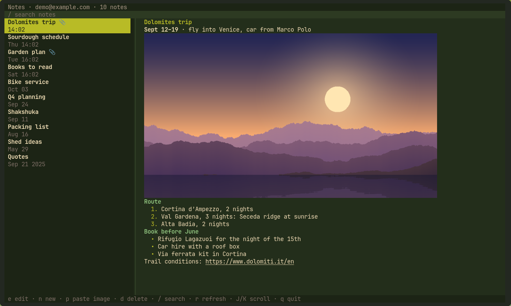

# jotmail

The iPhone's IMAP notes, in a terminal.

When an iPhone syncs Notes with an IMAP account (Settings → Mail → Accounts → *account* → Notes),
each note is stored as an HTML email in the account's `Notes` folder. jotmail reads and writes
that folder directly: no sync service, no server component, and edits show up on the phone as
edits, not duplicates.



- Browse, search, edit and delete notes in a two-pane terminal UI; notes open in `$EDITOR` as Markdown.
- Images in notes are shown inline in kitty and Ghostty, including inside tmux. Add one by
  pasting it from the clipboard, or by writing its path in the note.
- If a note changes on the phone while you edit it, the save is refused and your text is kept.
- Scriptable: `list`, `show`, `new`, `edit` and `rm` work without the UI.

## Build

Needs a C++20 compiler, CMake 3.24+, OpenSSL, iconv and zlib; libwebp is used for WebP images
when present. FTXUI, toml++, vmime and stb are fetched at configure time.

```sh
cmake -S . -B build -G Ninja -DCMAKE_BUILD_TYPE=Release
cmake --build build
```

Run the tests with `ctest --test-dir build`.

## Configure

`~/.config/jotmail/config.toml`:

```toml
default = "personal"
images = "auto"                                      # "auto", "kitty" or "off"
# paste_command = "wl-paste --type image/png"        # optional; see Images

[accounts.personal]
host = "imap.example.com"
port = 993                                           # optional, implicit TLS
user = "me@example.com"
password_command = "pass show mail/me@example.com"   # first line of output is the password
folder = "Notes"                                     # optional
# ca_file = "~/certs/my-ca.pem"                      # optional: also trust this CA (self-hosted servers)
```

`password_command` runs through `/bin/sh`, so `pass`, `secret-tool`,
`security find-internet-password -w` or `op read` all work.

## Try it without an iPhone

`tools/demo/demo up` starts a throwaway IMAP server in Docker, fills its `Notes` folder with
sample notes and writes a config for it (it needs Docker, OpenSSL and Python 3):

```sh
tools/demo/demo up
XDG_CONFIG_HOME=$XDG_RUNTIME_DIR/jotmail-demo/config jotmail
tools/demo/demo down
```

## Use

```sh
jotmail                     # browse
jotmail -a work             # another account
jotmail list                # number, date and title of every note
jotmail show 3              # a note's text, by number or UUID prefix
jotmail new < note.md       # add a note
jotmail edit 3              # edit in $EDITOR (or: jotmail edit 3 < note.md)
jotmail rm 3                # move to Trash
```

| Key | |
|---|---|
| `j` `k` / arrows | move |
| `enter` / `e` | edit the note in `$VISUAL` or `$EDITOR` |
| `n` | new note |
| `p` | paste the clipboard's image into the note |
| `d` `d` | move the note to Trash |
| `/` | search titles and text; `esc` clears |
| `J` `K`, `PgDn` `PgUp` | scroll the note |
| `r` | reload |
| `q` | quit |

A note's text is Markdown: `#` headings, `**bold**`, `*italic*`, `- ` and `1. ` lists and links.
An image appears as an `[attachment:…]` line; keep the line to keep the image, delete it to
drop the image.

## Images

To add an image, write a line with its path where it should go, and save:

```
[attachment:~/Pictures/receipt.jpg]
```

jotmail attaches the file (PNG, JPEG, GIF, WebP or HEIC) and rewrites the line to the image's
id. A path starts with `/`, `~`, `./` or `../`. This works in the editor, with `jotmail edit`,
and with `jotmail new`.

`p` in the browser does the same with the clipboard's image: it adds the line at the end of the
note and opens the editor, so you can move it, or delete it to cancel. The clipboard is read
with `wl-paste` (Wayland), `xclip` (X11) or `pngpaste` (macOS); set `paste_command` to a
command that prints the image to use anything else.

With `images = "auto"`, images are drawn in kitty and Ghostty with the kitty graphics protocol.
Inside tmux they need passthrough enabled:

```
set -g allow-passthrough on
```

## Theme

```toml
[theme]
preset = "forest"        # forest, gruvbox, nord or terminal
accent = "#fabd2f"       # and any colour below, to change just that one
```

| Colour | Used for |
|---|---|
| `background` | the note |
| `panel` | the list, status bar and footer |
| `text` | text |
| `muted` | dates, hints |
| `status` | the status bar's text |
| `accent` | the selected note, headings, bullets |
| `link` | links, second-level headings |
| `highlight` | the open search bar, the divider |
| `search` | the search bar |
| `selected-text` | text on the selected note |

A colour is `#rrggbb`, `default` (the terminal's own), an ANSI name (`red`, `bright-black`, …)
or a 256-colour number. The `terminal` preset uses only the terminal's own colours, so it
follows your terminal theme.

## License

GPL-3.0-or-later. See [LICENSE](LICENSE).
